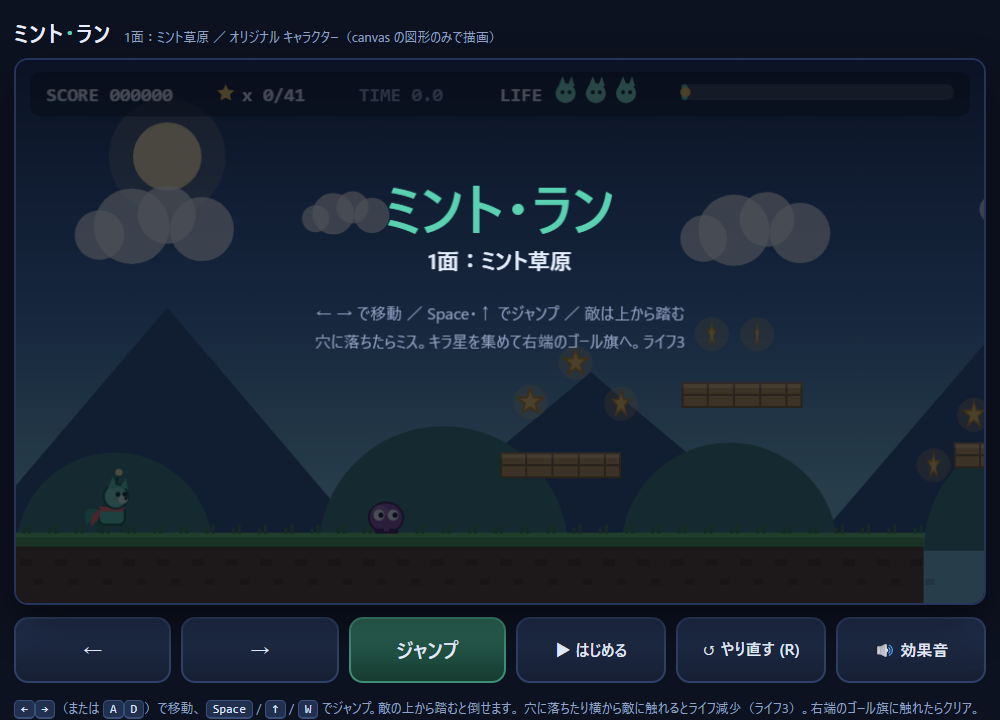

# ミント・ラン — ローカルLLMに1回の指示で作らせた横スクロールアクション

ローカル環境で動かしているLLM（Qwen3.8-Flash-Next）を、コーディングエージェントの Qwen Code から使い、
**指示を1回渡しただけ**で作らせたブラウザゲームです。
コード（`index.html`）は生成されたものを手を加えずに置いています。あわせて、作業時間・トークン量と、
完成後の動作確認で分かったことを記録しています。



## 遊び方

**ブラウザで遊ぶ：https://yuichiro-yokote.github.io/mint-run/**

手元では `index.html` をブラウザで開くだけで動きます（外部ライブラリ・画像・通信なし）。

- 左右キー（または A / D）で移動、Space・上キー・W でジャンプ
- 画面下のボタンでもマウスで操作できます
- 敵は上から踏むと倒せます。横から当たる・穴に落ちるとミス（ライフ3）
- 星を集めながら右端のゴール旗を目指します。R キーでやり直し

## 作り方

| 項目 | 内容 |
|---|---|
| エージェント | Qwen Code 0.25.2（デスクトップ版） |
| モデル | Qwen3.8-Flash-Next（ローカル環境で動作） |
| 指示 | 1回のみ。途中の修正依頼なし。全文は下記（[PROMPT.md](PROMPT.md) にも同じものを置いています） |
| 作業時間 | 約46分 |
| モデル呼び出し | 68回 |
| トークン | 入力 約650万（呼び出しごとに会話全体を送り直した合計）、出力 約10万（うち思考 約6万） |
| 成果物 | `index.html` 1ファイル、751行 |

Qwen は途中で Node.js のテストコードを自分で書いて約20回実行し、
「プレイヤーの当たり判定の幅・高さが未定義」「穴の上に足場が置かれていた」の2件を自分で修正しました。

### 渡した指示（全文）

```text
マリオのような横スクロールのアクションゲームを作ってください。
ただし、マリオのキャラクター・名前・画像は使わず、オリジナルのデザインにしてください。

【ファイル】
- index.html 1ファイルだけで完結させる（HTML・CSS・JavaScriptを全部入れる）
- 外部のライブラリ、CDN、画像ファイルは使わない（キャラや地形はcanvasで図形として描く）

【遊び方】
- 左右キーで移動、スペース（または上キー）でジャンプ
- 画面の下に、マウスでも押せる「←」「→」「ジャンプ」ボタンを付ける
- 重力があり、地面やブロックの上に乗れる。穴に落ちたらミス
- 主人公が進むと画面が横にスクロールする
- 左右に歩く敵がいる。上から踏むと倒せる。横から当たるとミス
- コインを取るとスコアが増える
- ステージの右端にゴールの旗があり、触るとクリア表示
- ライフ3、ゲームオーバー後にRキーかボタンでやり直し

【その他】
- ステージは1面で、端から端まで1〜2分で遊べる長さ
- コードには日本語で短くコメントを付ける
完成したら、ブラウザで開く方法を教えてください。
```

## 動作確認の結果

完成したものをブラウザで動かし、コードと合わせて確認しました。

**指示どおりに動いたもの**

- 指示した項目（移動・ジャンプ、画面下のボタン、足場、穴でミス、横スクロール、敵の踏みつけと横からの接触、スコア、ゴール、ライフ3とやり直し、日本語のコメント）はすべて実装されていた
- 敵を踏むと +200点、ゴール時に残り時間に応じたボーナスが入る
- 3回ミスするとゲームオーバーになり、R キーまたはボタンでやり直せる

**見つかった不具合**

- 低い足場が8か所あり、その下ではジャンプの上昇が1〜6px しかない（通常は約135px）。そのうち6か所では足場の下を敵が往復している。Qwen の自己テストでは検出されなかった
- やり直した後も、ボタンの表示が「走行中」に変わらず「はじめる」のまま
- タイトル画面で Space を押してもゲームが始まらない（開始はボタンのみ）
- 敵の上にゆっくり落ちる（落下速度が一定未満）と、踏みつけではなくミスになる
- テスト用の `window.MINT_TEST` がコードに残っている
- 画面幅が約650px のとき、下のボタンが横にはみ出す

## ファイル

- `index.html` … ゲーム本体（生成されたまま）
- `PROMPT.md` … Qwen に渡した指示の全文
- `docs/preview.png` … 画面の画像
